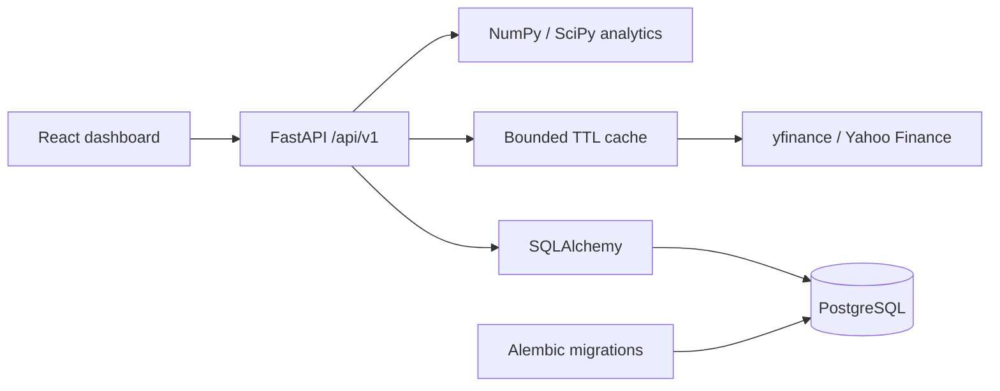

# MarketLens

**A full-stack quantitative finance research platform built with Python, FastAPI,
React, and TypeScript.**

MarketLens brings market history, Monte Carlo simulation, financial risk, options
pricing, portfolio optimization, and strategy backtesting into one dark-themed
dashboard. This software engineering portfolio project emphasizes reproducible
calculations, explicit assumptions, validated APIs, and numerical tests.

**Simulation and research only. No brokerage integration or live trading.**

## Features

| Area | Implemented capabilities |
| --- | --- |
| Market data | Equity/ETF search, adjusted daily prices, returns, volatility, expiring provider cache |
| Monte Carlo | Seeded GBM, sample paths, prediction bounds, terminal distributions and loss probability |
| Risk | Sharpe, Sortino, historical VaR/CVaR and maximum drawdown |
| Options | European Black–Scholes–Merton calls/puts and Greeks |
| Portfolios | Weighted returns, covariance, long-only minimum variance, weight caps and target returns |
| Backtesting | Moving-average strategy, next-close execution, fees, trade ledger and buy-and-hold comparison |
| Saved research | Save/load/update/delete portfolio definitions with optimistic version checks |
| Dashboard | Responsive UI, Recharts, CSV import, explicit loading/error/empty states |
| Deployment | Dockerfiles, Compose, Alembic migrations, Nginx and Render configuration |

The application runs locally. A public cloud deployment and real PostgreSQL/Docker
runtime have **not yet been verified**. Persistence tests use SQLite; an opt-in
PostgreSQL integration test is ready.

## Technology

- **Analytics:** Python, NumPy, Pandas, SciPy, yfinance
- **API:** FastAPI, Pydantic, Uvicorn
- **Storage:** PostgreSQL target, SQLAlchemy, Alembic, Psycopg; explicit SQLite development option
- **Frontend:** React, TypeScript, Vite, Tailwind CSS, Recharts
- **Testing:** pytest, Vitest, Testing Library
- **Deployment:** Docker Compose, Nginx, environment configuration
- **Optional native engine:** C++17/pybind11 GBM kernel, parity tests and reproducible benchmarks

## Architecture



Numerical functions are tested independently of provider calls. Downloads sit
behind an adapter so API tests can mock market data. Saved portfolios preserve
research inputs; version checks prevent stale browser tabs from overwriting changes.

## Local setup

Use Python **3.14** and Node **24 LTS**, the versions used for local verification.
From the repository root in PowerShell:

```powershell
python -m venv backend/.venv
./backend/.venv/Scripts/python.exe -m pip install -r backend/requirements-dev.txt -c backend/requirements-lock.txt
npm --prefix frontend ci
./backend/.venv/Scripts/python.exe -m uvicorn backend.main:app --reload --port 8000
```

In a second terminal:

```powershell
npm --prefix frontend run dev
```

Open **http://127.0.0.1:5173**. API documentation is at
**http://127.0.0.1:8000/docs**. On macOS/Linux, use `backend/.venv/bin/python`.

Analytics works without a database. For persistence, see the
[database/deployment guide](deploy/README.md). The Windows `deploy/start-local.ps1`
helper explicitly configures SQLite, runs migrations and starts both servers.
It refuses to replace occupied ports. SQLite is a local development option, not
a substitute for PostgreSQL verification.

## Configuration and secrets

`.env.example` documents backend **process environment** variables; FastAPI does
not load it automatically. `frontend/.env.example` documents public Vite settings.
`deploy/setup-env.ps1` generates private Compose credentials without printing them.

| Variable | Purpose |
| --- | --- |
| `MARKETLENS_DATABASE_URL` | Private server-side database connection string |
| `MARKETLENS_CORS_ORIGINS` | Allowed browser origins, comma-separated |
| `MARKETLENS_MARKET_TIMEOUT_SECONDS` | Provider timeout |
| `MARKETLENS_CACHE_TTL_SECONDS` | Market-result cache lifetime |
| `MARKETLENS_CACHE_MAX_ENTRIES` | Maximum cache entries |
| `VITE_API_BASE_URL` | Public backend URL; never a credential |

The current yfinance adapter requires no application API key. Real `.env` files,
private keys, databases, backups, dependencies, caches and builds are excluded from
Git; placeholder `.env.example` files are tracked. **Anything prefixed `VITE_` can
appear in the browser bundle.** Store future provider keys only on the backend.
If a real secret is ever committed, revoke/rotate it: `.gitignore` cannot erase Git
history or undo exposure.

## Free hosting

Use **Render Static Site** for React and a **Render Free Web Service** for FastAPI.
The root `render.yaml` and [hosting walkthrough](docs/HOSTING.md) describe setup.
Free services have cold starts and usage limits. Render's free PostgreSQL expires
after 30 days; Neon is an alternative free PostgreSQL provider for later storage.

The supplied public demo intentionally leaves storage unconfigured. The saved
portfolio API is currently single-user, with **no authentication or ownership
isolation**. Protect the application before connecting private saved data to a
public instance. A hidden database password does not authorize application users.

## Verification

```powershell
./backend/.venv/Scripts/python.exe -m pytest -q
npm --prefix frontend test
npm --prefix frontend run build
```

Latest local results: **128 backend tests passed, one PostgreSQL test skipped,
21 frontend tests passed**, and the TypeScript/Vite build passed.

Tests cover reference option prices, finite-difference Greeks, GBM moments and
seeds, historical risk, analytic portfolio solutions, next-close trade accounting,
future-data perturbations, provider failures, input validation, caching, migrations,
persistence, conflicting updates, CSV parsing and stale frontend requests.

Verification limits: browser screenshot/layout testing was blocked in the sandbox;
chart layout is mocked in component tests. Cloud market downloads, PostgreSQL and
Linux Docker builds still require deployment verification. A Starlette test-client
deprecation warning remains.

## Model assumptions

- API rates are decimal fractions; percentage form fields convert explicitly.
- Sample volatility uses `ddof=1` and defaults to 252 observations per year.
- GBM assumes constant drift/volatility and lognormal prices; prediction bands
  describe simulated outcomes, not reliable real-world forecasts.
- Black–Scholes–Merton assumes European exercise and constant market parameters.
- Portfolio estimates are in-sample and assume costless periodic rebalancing.
- Strategy signals execute at the **following close**. Timing tests do not remove
  survivorship bias, parameter-selection bias or unrealistic fill assumptions.
- This is research software, not investment advice or a certified risk system.

See [development/model documentation](docs/DEVELOPMENT.md) for detailed conventions.

## Roadmap

- [x] Python analytics engine and numerical tests
- [x] Market-data adapter and validated REST APIs
- [x] Portfolio optimization and historical backtesting
- [x] React dashboard and frontend tests
- [x] Persistence models, migrations and saved-portfolio UI
- [x] Docker/Render configuration and documentation
- [ ] Verify PostgreSQL and Docker deployment end to end
- [ ] Publish and validate a hosted portfolio demo
- [ ] Add authentication and per-user authorization for shared persistence
- [x] Implement optional C++ Monte Carlo with pybind11 and numerical parity tests
- [x] Benchmark against NumPy; local call timings and scope are documented in [native/README.md](native/README.md)
- [ ] Extend walk-forward evaluation and deployment monitoring

## Repository layout

```text
backend/
  api/             REST routes and request/response contracts
  quant/           Analytics, optimization, backtesting and market-data adapter
  migrations/      Versioned database schema
  tests/           Numerical, API and persistence tests
frontend/src/      Dashboard, charts, forms and frontend tests
deploy/            Dockerfiles, Compose, Nginx and local helpers
docs/              Development notes and hosting walkthrough
render.yaml        Free-tier public-demo configuration
native/            Optional C++ kernel, build helper and benchmark results
scripts/           Redacting Git secret-audit helper
```

MarketLens is developed incrementally, with each phase checked before expanding
the scope. The goal is understandable, reproducible full-stack engineering with
honest model limitations and measured performance.

Before publishing changes, run `python scripts/audit_secrets.py --history` after
staging. It checks staged content and reachable Git history for private/generated
paths and common credential patterns, reporting filenames only. This is a heuristic
check, not proof that every possible secret is absent. Keep real credentials in
ignored environment files or private hosting settings and enable GitHub secret
scanning/push protection where available. Compiled native binaries are ignored.
