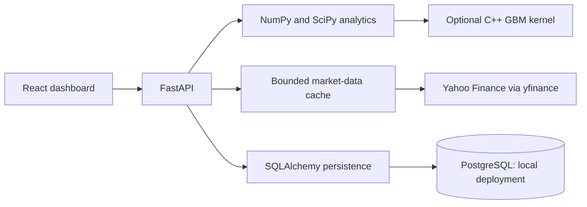

# MarketLens

**A full-stack quantitative finance research platform for exploring markets, modeling uncertainty, and evaluating investment strategies.**

[Open the dashboard](https://marketlens-web-autn.onrender.com)

MarketLens brings financial analytics into one interactive, dark-themed workspace. Explore historical prices, simulate stock paths, measure portfolio risk, price European options, and examine historical strategy performance.

Built as a software engineering portfolio project, it combines numerical modeling, validated APIs, database persistence, a responsive React interface, and an optional C++ computation engine.

**Simulation and research only. No live trading or brokerage execution.**

## What you can explore

| Workspace | Capabilities |
| --- | --- |
| Market overview | Stock and ETF search, adjusted daily prices, returns, and volatility |
| Monte Carlo | Reproducible Geometric Brownian Motion simulations, price paths, prediction bands, terminal distributions, and loss probabilities |
| Risk analytics | Sharpe ratio, Sortino ratio, historical VaR, CVaR, and maximum drawdown |
| Options pricing | European Black–Scholes–Merton call and put pricing with Greeks |
| Portfolios | Weighted return analysis, covariance, and long-only mean-variance optimization with weight caps and target returns |
| Backtesting | Moving-average strategies, next-close execution, transaction fees, trade ledgers, and buy-and-hold comparisons |
| Saved research | Portfolio definitions with version checks to reject conflicting updates; available in the local database deployment |

## Public demo

The React dashboard and FastAPI backend are deployed as separate Render services. The free backend may take about a minute to wake after inactivity. Market data depends on Yahoo Finance availability and provider limits.

Public saved-portfolio storage remains disabled pending authentication and per-user authorization. The local Docker deployment supports PostgreSQL persistence. Cloud connectivity and full end-to-end validation are still being finalized.

## Technology

| Layer | Stack |
| --- | --- |
| Frontend | React, TypeScript, Vite, Tailwind CSS, Recharts |
| API | Python, FastAPI, Pydantic, Uvicorn |
| Quantitative analytics | NumPy, Pandas, SciPy, yfinance |
| Persistence | PostgreSQL, SQLAlchemy, Alembic |
| Native computation | C++17 and pybind11 |
| Testing | pytest, Vitest, Testing Library |
| Deployment | Docker Compose, Nginx, Render, GitHub Actions workflow |

## Architecture

Financial calculations are separated from API routing, external data providers, and storage. This keeps models testable without network access and allows the interface to share a consistent set of validated endpoints.

## Engineering highlights

- **Reproducible simulations:** explicit seeds and numerical parity checks between Python and the optional C++ engine.
- **Input validation:** bounded workloads, validated financial inputs, and structured API errors.
- **Backtest timing:** signals execute at the following close, with tests that perturb future data to detect look-ahead errors.
- **Reliable persistence:** versioned migrations and optimistic concurrency checks for saved portfolios.
- **Secret handling:** backend environment configuration and exclusions for credentials, local databases, dependencies, and generated artifacts.
- **Measured performance:** reproducible native benchmarks with their methodology and limits documented in [native engine results](native/README.md). NumPy remains the default engine.

## Validation

The latest recorded local test run passed **128 backend tests and 21 frontend tests**, with one optional PostgreSQL integration test skipped. The TypeScript/Vite production build also passed.

A separate HTTP smoke test against the local Docker deployment verified database readiness, reference option pricing, simulations, portfolio CRUD, and stale-write rejection. These checks do not establish a passing cloud deployment or GitHub Actions run.

Coverage includes reference values, finite-difference Greeks, simulation moments, portfolio solutions, transaction accounting, provider failures, migrations, CSV parsing, and stale frontend requests.

## Model assumptions

- GBM assumes constant drift and volatility with lognormal prices. Simulation bands describe model outcomes, not reliable forecasts.
- Black–Scholes–Merton assumes European exercise and constant market parameters.
- Portfolio estimates are in-sample and assume costless periodic rebalancing.
- Historical strategy results remain subject to survivorship bias, parameter selection, and simplified execution assumptions.
- This is research software, not investment advice or a certified risk system.

## Roadmap

- [x] Financial analytics engine and validated REST APIs
- [x] Interactive dashboard and visualization workflows
- [x] Portfolio optimization and historical backtesting
- [x] PostgreSQL persistence and local Docker deployment checks
- [x] Optional C++ simulation engine and documented benchmarks
- [x] Publish frontend and backend services
- [ ] Complete hosted API connectivity and browser verification
- [ ] Add authentication and per-user saved portfolios
- [ ] Extend walk-forward strategy evaluation
- [ ] Add deployment monitoring and broader browser testing

MarketLens is developed incrementally, with an emphasis on understandable models, maintainable code, and honest validation of results.
